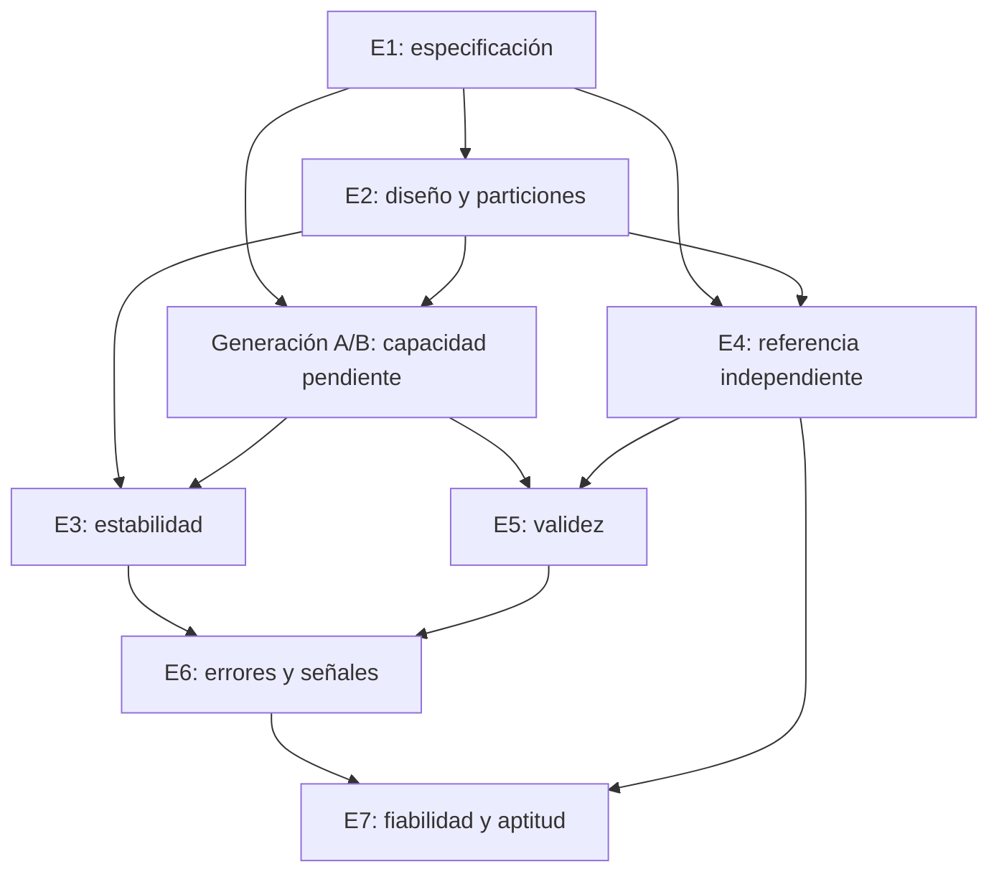

# Crear y dirigir un laboratorio de extracteval

> **Flujo vigente:** consulta [Laboratorio YAML/JSON](laboratorio-yaml-json.md). Los recorridos con CSV/TXT y varias vistas del diccionario que aparecen más abajo corresponden al formato anterior o a ejemplos didácticos; no son pasos adicionales para `mi_estudio_001`.

## 1. Qué entrega este procedimiento

Este procedimiento crea una estructura reutilizable para organizar un estudio: carpetas, archivos vacíos para entradas y resultados, formularios de decisiones, una lista de 49 actividades y un tablero de siete etapas. Incluye un comando que prepara un laboratorio nuevo y otro que consulta sus registros de avance.

**No ejecuta las siete etapas científicas.** No llama a modelos, no lee tu corpus, no procesa anotaciones, no calcula métricas y no entrena estimadores. Se conserva el alcance de la Fase 1 del paquete; el nuevo script es una herramienta de organización externa al núcleo.

La referencia conceptual es el PDF proporcionado por el usuario, *Framework_Metodologico_LLMs (3).pdf*, especialmente las secciones 3.1–3.12, páginas 1–6. La plantilla registra su huella en `control/fuente_metodologica.json`. Las decisiones de carpetas, nombres, estados y formatos son propuestas de implementación de esta guía, no exigencias textuales del PDF.

## 2. Por qué siete etapas

Las siete etapas responden a preguntas distintas y reúnen evidencias que no se sustituyen unas a otras:

| Etapa metodológica | Pregunta que responde | Por qué no basta la anterior |
|---|---|---|
| E1. Especificación operacional | ¿Qué significa extraer correctamente cada variable? | Sin una definición no existe un criterio estable de corrección. |
| E2. Diseño estadístico | ¿A qué población se aplica la conclusión y cómo obtendremos evidencia? | Una buena definición no elimina sesgos de muestra, dependencia o fuga. |
| E3. Estabilidad | ¿Se mantienen las respuestas al repetir o perturbar condiciones? | Un diseño correcto no demuestra consistencia del procedimiento. |
| E4. Referencia independiente | ¿Contra qué interpretación documental contrastamos el sistema? | Repetir siempre el mismo valor no demuestra que sea correcto. |
| E5. Validez y verificación | ¿Cuánto acierta y qué cambia al incorporar verificación? | Disponer de una referencia no cuantifica por sí solo desempeño ni beneficio neto. |
| E6. Errores y señales | ¿Cómo falla y qué señales observables describen su riesgo? | Un promedio global puede ocultar tipos de error o variables problemáticas. |
| E7. Fiabilidad y aptitud | ¿Qué probabilidad de corrección se sostiene y para qué uso se acepta? | Detectar señales no garantiza probabilidades calibradas ni una política de uso adecuada. |

El resultado del framework es una evaluación documentada y condicionada por un propósito. No es una certificación universal ni una garantía de verdad de cada caso.

El PDF distingue conformidad estructural, estabilidad, validez documental y fiabilidad calibrada. Una salida con JSON válido puede ser incorrecta; una salida estable puede repetir errores; acuerdo entre agentes no equivale a exactitud. La referencia describe la interpretación del documento y no verifica necesariamente el hecho en fuentes externas.

### Orden lógico frente a ejecución lineal

Las carpetas numeradas muestran responsabilidades y procedencia, no un motor que ejecuta siete comandos consecutivos. Parte de E1 y E2 puede prepararse en paralelo; la referencia de E4 puede construirse mientras se estudia E3, manteniendo el cegamiento. Los pilotos pueden motivar revisiones antes de congelar el protocolo. E5 requiere referencia y salidas comparables; E7 requiere señales, etiquetas suficientes y particiones autorizadas.



Este diagrama resume relaciones de evidencia; no representa dependencias de importación ni exige utilizar todos los resultados de una etapa en cada análisis posterior. El ajuste de fiabilidad usa solo las particiones autorizadas, aunque el diagrama muestre las capacidades globales.

## 3. No confundir etapas metodológicas con fases de software

| Concepto | Qué significa | Estado actual |
|---|---|---|
| Siete etapas metodológicas | Trabajo científico que debe producir evidencia | Este laboratorio permite planearlas y documentarlas; inicialmente todas pendientes |
| Fase 1 de implementación | Contratos, puertos, mocks y pruebas | Implementada en `extracteval` 0.1.0 |
| Fase 2 de implementación | Importación de A, verificación independiente, comparación y reconciliación | Implementadas en 0.2.0; extractor A disponible con configuración independiente |
| Fase 3 de implementación | Repetibilidad completa y A fija, perfiles descriptivos e informes | Implementada y probada con mocks; ejecución real y validación científica pendientes |
| Fases posteriores de implementación | Estadística confirmatoria, calidad y calibración | Pendientes |
| Este organizador | Crear archivos y consultar control manual | Disponible como script del repositorio |

No hay equivalencia «Fase 1 del software = E1 científica terminada». Para E1 todavía debes definir y revisar el diccionario de tu estudio. La existencia de `ExpertAnnotation` no implica que E4 ya tenga anotaciones reales.

### Cobertura científica del documento

El PDF explicita variables categóricas, binarias y temporales y exige funciones apropiadas a su escala. El núcleo también representa números y texto; esa posibilidad técnica no constituye por sí sola validación metodológica de cualquier variable numérica o textual. Debes definir su criterio de corrección y análisis.

El PDF contiene encabezados pendientes, incluidos diseño experimental y aplicación EPOC de la página 7; no proporciona allí un diccionario completo, tamaño muestral ni umbrales de aceptación listos para ejecutar. El laboratorio deja esas decisiones vacías deliberadamente. También aparecen títulos de framework en los capítulos 2 y 3; esta guía usa el desarrollo sustantivo del capítulo 3, sin modificar el documento fuente.

## 4. Crear un laboratorio nuevo

### Paso 1. Abrir la terminal en el proyecto

```sh
cd /Users/jonathancamposlozano/Documents/Phd/Framework
```

El script utiliza únicamente la biblioteca estándar de Python 3.11 o superior. Puedes usar el intérprete del entorno ya instalado; no requiere API keys ni instalar proveedores.

### Paso 2. Ejecutar el creador

```sh
.venv/bin/python scripts/laboratorio.py crear --destino laboratorios/mi_estudio_001
```

El nombre es tu elección. También puedes proporcionar una ruta absoluta de un proyecto externo donde tengas permisos de escritura. El directorio padre puede existir, pero el destino final debe ser nuevo.

El comando copia la plantilla `templates/laboratorio/` y crea `control/creacion.json`. No lee documentos de tu equipo ni crea una ejecución del LLM. Si el destino ya existe, se detiene sin sobrescribirlo. Si falta espacio o permiso durante la copia puede quedar una estructura parcial: revisa el error y usa otro destino; no reutiliza automáticamente el parcial.

### Paso 3. Leer y delimitar el estudio

Abre `LEEME_PRIMERO.md` y completa `control/alcance.md`. Define pregunta, uso, población, responsables y capacidades de software pendientes.

### Paso 4. Consultar el tablero

```sh
.venv/bin/python scripts/laboratorio.py estado --laboratorio laboratorios/mi_estudio_001
```

Al inicio mostrará siete etapas `pendiente` y cero actividades completadas. No es un fallo: aún no se ha producido evidencia científica.

En esta entrega se ha creado además `laboratorios/laboratorio_001`, listo para que lo completes. No necesitas ejecutar el creador sobre esa misma ruta.

## 5. Estructura y ubicación de tus archivos

```text
laboratorio/
├── LEEME_PRIMERO.md
├── control/
│   ├── alcance.md
│   ├── estado_etapas.csv
│   ├── lista_chequeo.csv
│   ├── registro_cambios.csv
│   ├── inventario_artefactos.csv
│   ├── congelacion_protocolo.md
│   ├── mapa_etapas.json
│   ├── fuente_metodologica.json
│   └── creacion.json
├── datos/
│   └── documentos/
│       ├── documentos.jsonl
│       └── inventario_documentos.csv
├── 01_especificacion/
│   ├── diccionario_variables.csv
│   ├── diccionario.borrador.json
│   ├── esquema_salida.borrador.json
│   ├── criterios_correccion.csv
│   ├── reglas_consistencia.csv
│   ├── politicas_informacion.md
│   ├── revision_experta.md
│   ├── proposito.md
│   └── prompts/
│       ├── extractor_v1.txt
│       └── verificador_v1.txt
├── 02_diseno/
│   ├── protocolo_estadistico.md
│   ├── plan_analisis.md
│   ├── control_acceso_evaluacion.md
│   ├── muestra.csv
│   └── particiones.csv
├── 03_estabilidad/
│   ├── plan_repeticiones.csv
│   ├── plan_perturbaciones.csv
│   ├── condiciones.borrador.json
│   ├── resultados/perfiles.csv
│   └── informe.md
├── 04_referencia/
│   ├── protocolo_anotacion.md
│   ├── evaluador_01/anotaciones.csv y anotaciones.jsonl
│   ├── evaluador_02/anotaciones.csv y anotaciones.jsonl
│   ├── adjudicacion/decisiones.csv y referencia_final.jsonl
│   ├── resultados/concordancia.csv
│   └── limitaciones.md
├── 05_validez/
│   ├── pares_evaluables.csv
│   ├── resultados/pgec_comparacion.csv
│   ├── resultados/por_variable.csv
│   ├── resultados/transiciones_errores.csv
│   └── informe.md
├── 06_calidad/
│   ├── taxonomia_errores.csv
│   ├── errores_observados.csv
│   ├── definicion_senales.csv
│   ├── senales_observables.csv
│   └── informe.md
├── 07_fiabilidad/
│   ├── plan_fiabilidad.md
│   ├── modelos/registro.csv
│   ├── resultados/probabilidades.csv
│   ├── resultados/calibracion.csv
│   ├── resultados/riesgo_cobertura.csv
│   ├── politica_uso.md
│   └── informe.md
├── configuraciones/experimento.borrador.json
└── ejecuciones/
    ├── REGISTRO.csv
    ├── LEEME.md
    ├── A/
    ├── B/
    └── revision_operativa/
```

Los nombres en el árbol resumen los archivos; el comando crea cada archivo por separado. Los `.gitkeep` solo conservan carpetas inicialmente vacías.

### Qué significa «en blanco»

- Prompts y JSONL: archivos sin contenido y sin registros.
- CSV de entradas/resultados: únicamente encabezados; no contienen personas, etiquetas, cifras ni ceros que parezcan resultados.
- Documentos Markdown: apartados que debes completar, sin decisiones ya tomadas.
- `.borrador.json`: formularios con nulos o listas vacías y marca `borrador_no_ejecutable`. No son aún `ExperimentConfig`, `OperationalDictionary` o esquemas listos para consumir.
- Archivos de control: contienen los nombres de etapas, actividades previstas y criterios de cierre; sus estados son `pendiente`. Esa planificación no equivale a datos del estudio.
- `creacion.json`: registro administrativo real de creación, distinto de un `RunManifest` experimental.

CSV y JSONL son opciones de captura/conversión. Si tus evaluadores trabajan en CSV, fija ese como fuente original y convierte a JSONL de manera documentada cuando exista esa integración. No edites dos copias de la misma anotación en paralelo. No hay importación automática desde CSV, Excel, PDF, SQLite o estas carpetas.

## 6. Cómo registrar qué etapa está en curso

El tablero tiene dos archivos maestros con funciones diferentes:

| Archivo | Qué registras |
|---|---|
| `control/estado_etapas.csv` | Estado y producto global de cada etapa |
| `control/lista_chequeo.csv` | Cumplimiento de cada una de las 49 actividades |

Puedes abrirlos como texto CSV o importarlos en tu hoja de cálculo con codificación UTF-8 y separador coma. Conserva los nombres de columnas e identificadores. Si escribes comas en una celda, el editor debe guardarla entre comillas según CSV.

Estados admitidos: `pendiente`, `en_curso`, `bloqueado`, `completado`, `no_aplica`.

`no_aplica` permite delimitar un piloto o una pregunta más acotada con justificación. No permite afirmar que se completó la evaluación multidimensional de siete etapas si se excluyó evidencia esencial para esa conclusión. El informe debe declarar el alcance efectivamente realizado.

### Ejemplo de actualización, sin resultados inventados

Cuando comiences a definir el diccionario:

1. En `estado_etapas.csv`, localiza E1.
2. Cambia `estado` a `en_curso`, escribe responsable y fecha de inicio.
3. En `lista_chequeo.csv`, localiza E1.02 y marca también `en_curso`.
4. Completa las definiciones y somételas a revisión.
5. Cuando satisfagan el criterio, cambia E1.02 a `completado` y registra fecha y `evidencia_real`, por ejemplo `01_especificacion/diccionario_variables.csv`.
6. Mantén E1 `en_curso` mientras falten esquema, políticas, criterios, revisión o congelación.
7. Al cerrar toda la etapa, escribe en `resultado_obtenido` un resumen de lo efectivamente aprobado y en `ruta_evidencia` un informe o acta que lo documente. Completa `validado_por`.

Las rutas de evidencia son relativas al laboratorio y deben apuntar a un archivo. Si hay varios artefactos, apunta al informe que los identifica. No escribas texto documental sensible en las tablas de avance.

El script `estado` lee estas declaraciones, muestra producto esperado, resultado registrado y ruta de evidencia, y cuenta actividades. No detecta jobs ni modelos activos; `en_curso` lo establece el responsable. No altera el estado de los archivos. Devuelve código 1 si detecta algunas inconsistencias —por ejemplo, etapa completa con tareas pendientes, exclusión sin justificación o evidencia indicada inexistente/vacía— y código 2 ante problemas de formato/ruta. Código 0 solo significa que esos controles administrativos no detectaron inconsistencias.

**No se certifica la suficiencia científica por tamaño o existencia de un archivo.** Un CSV con solo encabezado puede tener bytes y seguir sin resultados. La revisión humana determina si se cumplen los criterios.

### Qué es soporte de software

El tablero imprime aparte:

- `parcial_contratos`: existen estructuras para representar parte del trabajo; no su ejecución completa.
- `manual_externo`: el diseño requiere decisiones y herramientas externas; no hay automatización implementada.
- `no_implementado`: la capacidad científica de esta etapa aún no está implementada en la biblioteca.

Estos valores no cambian cuando marques tareas como realizadas manualmente. Al desarrollar nuevas capacidades, habrá que revisar de forma explícita la matriz de soporte de la plantilla; no se actualiza sola.

## 7. Entradas, productos y criterios de cierre por etapa

| Etapa | Entradas necesarias | Producto que debes obtener | Cierre mínimo |
|---|---|---|---|
| E1 | Pregunta, documentos representativos, variables preliminares | Diccionario, esquema, reglas, políticas, ejemplos y corrección versionados | Revisión experta y versión congelada antes de confirmar |
| E2 | E1, población, agrupación, precisión y recursos | Protocolo, muestra, pesos, particiones, análisis e incertidumbre preespecificados | Separación por entidad y reserva de evaluación final documentadas |
| E3 | Configuración fija, subconjunto y plan de perturbaciones | Perfiles de repetibilidad/robustez y concordancia, con incertidumbre | Salidas originales y condiciones conservadas; sin confundir acuerdo con acierto |
| E4 | Diccionario congelado, documentos y evaluadores independientes | Anotaciones, concordancia previa, adjudicación, evidencia y razones | Originales conservados, cegamiento y particiones documentados |
| E5 | A/B pareados, referencia, elegibilidad y diseño | PGEC A/B, diferencia, IC95, métricas por variable y transiciones de error | Método respeta emparejamiento, pesos y agrupación; no presupone mejora de B |
| E6 | Discrepancias frente a referencia y salidas/condiciones observables | Taxonomía aplicada, distribuciones y señales versionadas | Señales para casos nuevos no contienen etiquetas expertas de esos casos |
| E7 | Señales, corrección experta suficiente y particiones autorizadas | Estimador fuera de ajuste, calibración, riesgo-cobertura y política de uso | Umbrales predefinidos; sin etiquetas finales para ajustar; límites por uso explícitos |

### E3: dónde se estudia el prompt

El prompt base está en `01_especificacion/prompts/`. Las repeticiones se planifican en `03_estabilidad/plan_repeticiones.csv`; los cambios controlados en `plan_perturbaciones.csv`.

Repetibilidad significa conservar condiciones nominalmente idénticas; robustez significa modificar una condición previamente definida y registrar las demás. Cada llamada real y su resultado irán en una carpeta nueva bajo `ejecuciones/A/` o `B/`, con su manifiesto y registro. Hoy el script no realiza esas llamadas ni calcula la frecuencia modal que propone el PDF, las diferencias temporales o sus intervalos.

No existe un número universal de repeticiones impuesto por la plantilla: debes justificarlo en el protocolo. Un guion mock constante no acredita estabilidad de un LLM.

### E4: dónde trabajan los evaluadores

Cada evaluador tiene una carpeta para su fuente original. Las tablas incluyen documento, variable, diccionario, partición, valor, evidencia y cegamiento declarado. Las razones de adjudicación se conservan en `decisiones.csv`; son necesarias aunque el contrato actual `AdjudicatedReference` no tenga un campo dedicado para el motivo.

Las carpetas no imponen permisos de acceso. El responsable debe entregar a cada evaluador únicamente el material autorizado y evitar acceso a salidas automatizadas durante anotación inicial. La revisión operativa tiene ubicación distinta de la referencia científica.

### E5: qué debe significar el resultado principal

PGEC requiere criterios de corrección y pares evaluables predefinidos. Su diferencia es B menos A sobre los mismos documentos y referencia. Las estimaciones e intervalos todavía deben calcularse con una implementación científica apropiada; el CSV vacío no los produce.

No se excluyen fallos del sistema a posteriori para mejorar la métrica. Las reglas para abstenciones, indeterminación y cobertura se deciden en E1/E2. No se tratan múltiples campos de una misma entidad como observaciones independientes.

### E7: cuándo no hay suficiente evidencia

No completes probabilidades ni curvas con valores arbitrarios. Si faltan etiquetas independientes o errores suficientes, documenta la limitación; no declares fiabilidad individual. El PDF permite priorizar evaluación agregada o por grupos cuando la información no permite estimaciones individuales estables.

Brier mide calidad probabilística global, no exclusivamente calibración. La aptitud depende de propósito, costo del error y capacidad de revisión; no de un umbral elegido retrospectivamente en evaluación final.

## 8. Tu procedimiento inicial de trabajo

1. Abre el laboratorio creado y completa el alcance.
2. Trabaja E1 y prepara E2; registra ambos `en_curso` solo si realmente comenzaron.
3. Coloca documentos pseudonimizados o referencias seguras. Conserva la correspondencia identificable fuera de este laboratorio si existe.
4. Define el origen y el procedimiento de extracción; mientras falte el adaptador/extractor real, registra el bloqueo de ejecución. Puedes preparar manualmente diccionario y diseño sin inventar salidas.
5. Prepara la anotación independiente después de estabilizar el diccionario, conservando el cegamiento.
6. Ejecuta pilotos solo en particiones autorizadas y registra cambios. No uses evaluación final para ajustar.
7. Congela protocolo, versiones, estimandos y políticas antes de la evaluación confirmatoria.
8. A medida que existan capacidades y resultados reales, incorpora sus productos y cierra actividades revisadas.
9. Usa el comando `estado` para consultar lo declarado y atender inconsistencias administrativas.
10. Conserva originales y nuevas versiones; nunca reemplaces datos de A por los reconciliados de B.

## 9. Qué queda listo y qué no

Quedan listos la estructura, los formularios vacíos, las 49 actividades, sus criterios y rutas esperadas, el creador reutilizable y la consulta de control manual.

Crear el laboratorio no completa sus siete etapas científicas. El paquete 0.2.0 añade carga local y verificación documental con comparación y reconciliación; el extractor A también está disponible con pruebas sintéticas; las métricas estadísticas siguen pendientes. Consulta [el extractor A](extractor-a.md). El creador de estructuras no ejecuta modelos ni garantiza por sí mismo cegamiento o autorización de acceso.

Los borradores deben convertirse a contratos válidos antes de ejecutar procedimientos. El tutorial sirve para aprender contratos; no debe mezclarse con resultados científicos. Las plantillas se crean sin datos; la demostración opcional de fase 2 usa entradas sintéticas separadas del corpus. Consulta [la guía de fase 2](fase2-verificacion-laboratorio.md).
