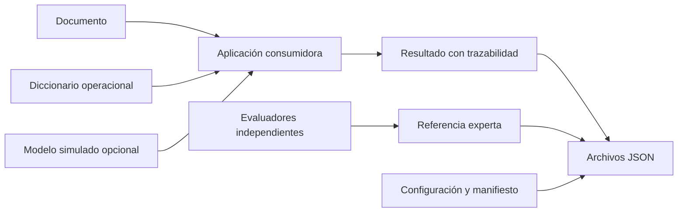

# Instructivo de uso de extracteval

**Versión del paquete:** 0.1.0. **Formato de contratos:** 1.0. **Alcance:** Fase 1.

**Comprobación del instructivo:** se ejecutaron sus 23 bloques Python en orden, el tutorial completo y su protección contra sobrescritura. Las 72 pruebas existentes, Ruff y mypy también pasan.

Esta guía enseña a instalar la biblioteca, definir variables, representar documentos, usar modelos simulados, registrar resultados y referencias expertas, conservar su procedencia y recuperar los datos guardados. Todos los ejemplos usan documentos administrativos ficticios.

El directorio del proyecto en esta máquina es:

```text
/Users/jonathancamposlozano/Documents/Phd/Framework
```

## Si necesitas organizar un estudio completo

Consulta [Crear y dirigir un laboratorio](crear-y-dirigir-un-laboratorio.md): prepara carpetas, archivos en blanco y un tablero con 49 actividades, alineado con las siete etapas del PDF metodológico. La creación no ejecuta esas etapas ni marca productos como obtenidos.

## Si quieres hacer tu propia prueba

Empieza por **[Cómo hacer tu propia prueba](tu-primera-prueba.md)**. Ese recorrido indica exactamente qué archivo copiar, qué campos editar, qué comando ejecutar y cómo comprobar un valor propio. Usa `examples/mi_primera_prueba.py`, sin mocks.

La distinción es fundamental: hoy puedes registrar y validar un valor que tú suministras. Si necesitas que un LLM lea documentos y obtenga automáticamente los valores, todavía falta la Fase 2. Cambiar el documento de una demostración no convierte un mock en un extractor.

## Índice

1. [Qué puedes hacer hoy](#1-qué-puedes-hacer-hoy)
2. [Conceptos y responsabilidades](#2-conceptos-y-responsabilidades)
3. [Instalación y comprobación inicial](#3-instalación-y-comprobación-inicial)
4. [Primer ejemplo](#4-primer-ejemplo)
5. [Tutorial completo con archivos](#5-tutorial-completo-con-archivos)
6. [Definir un diccionario operacional](#6-definir-un-diccionario-operacional)
7. [Representar documentos y evidencia](#7-representar-documentos-y-evidencia)
8. [Configurar y usar los modelos simulados](#8-configurar-y-usar-los-modelos-simulados)
9. [Construir y validar resultados](#9-construir-y-validar-resultados)
10. [Registrar referencia experta y adjudicación](#10-registrar-referencia-experta-y-adjudicación)
11. [Configurar experimentos y manifiestos](#11-configurar-experimentos-y-manifiestos)
12. [Guardar y recuperar contratos](#12-guardar-y-recuperar-contratos)
13. [Usarlo desde otro proyecto](#13-usarlo-desde-otro-proyecto)
14. [Referencia de campos y métodos](#14-referencia-de-campos-y-métodos)
15. [Errores frecuentes](#15-errores-frecuentes)
16. [Rutina recomendada de trabajo](#16-rutina-recomendada-de-trabajo)
17. [Límites actuales y siguientes fases](#17-límites-actuales-y-siguientes-fases)

## 1. Qué puedes hacer hoy

`extracteval` es una **biblioteca Python**. La aplicación que la utiliza importa sus clases y crea los objetos. En esta versión no existe un comando `extracteval run`, una interfaz gráfica ni un servicio que procese documentos automáticamente.

| Necesidad | Disponible en 0.1.0 | Forma de uso |
|---|---|---|
| Definir variables y categorías | Sí | `VariableDefinition` y `OperationalDictionary` |
| Validar tipos y dominios | Sí | Construcción de contratos y `validate_against` |
| Representar documentos y citas | Sí | `Document`, `Evidence`, `EvidenceAssessment` |
| Registrar una extracción ya disponible | Sí | Construir `ExtractionResult` manualmente |
| Probar llamadas a modelos sin red | Sí | `ConstantModel` y `ScriptedModel` |
| Registrar referencia experta | Sí | `ExpertAnnotation`, `AdjudicatedReference` |
| Versionar configuración y describir ejecuciones | Sí | `ExperimentConfig`, `ConfigRef`, `RunManifest` |
| Guardar y recuperar JSON | Sí, mediante Python | `model_dump_json`, `model_validate_json` y `pathlib` |
| Extraer variables automáticamente de texto | Pendiente | No hay extractor genérico todavía |
| Llamar a un proveedor real o motor local | Pendiente | No se incluyen adaptadores reales |
| Ejecutar verificación y reconciliación | Pendiente | No se incluyen sus flujos |
| Leer PDF, Word o bases de datos | Pendiente o responsabilidad externa | `Document` recibe texto o referencia; no convierte archivos |
| Calcular PGEC o diferencias entre arquitecturas | Pendiente | No hay métricas implementadas |
| Calibrar fiabilidad o decidir aptitud de uso | Pendiente | No hay estimador ni calibrador |

Los mocks devuelven contenido escrito de antemano. Un resultado válido para Pydantic significa que satisface restricciones del contrato; no demuestra corrección factual ni validez científica.

## 2. Conceptos y responsabilidades

El uso actual se puede entender mediante esta relación:



La aplicación consumidora realiza la composición. La biblioteca aporta los contratos, sus validaciones y los dos adaptadores simulados.

- **Documento:** unidad de contenido identificada con un pseudónimo.
- **Variable:** aquello que se quiere representar, con tipo y definición explícitos.
- **Diccionario:** conjunto versionado de variables.
- **Resultado:** registro del valor y de lo que ocurrió durante una operación.
- **Referencia experta:** anotación independiente destinada a evaluación científica.
- **Configuración:** condiciones planificadas del experimento.
- **Manifiesto:** descripción de una ejecución concreta y sus artefactos.
- **Artefacto:** archivo o contenido versionado identificado por una referencia y una huella SHA-256.

La misma configuración puede utilizarse para distintas ejecuciones. Sus identificadores de ejecución deben distinguirlas. Los contratos no asignan identificadores automáticamente ni verifican su unicidad entre archivos.

## 3. Instalación y comprobación inicial

### 3.1 Abrir una terminal y entrar al proyecto

Los siguientes comandos están preparados para la terminal de macOS con zsh o bash. No se escriben dentro del intérprete interactivo de Python.

```sh
cd /Users/jonathancamposlozano/Documents/Phd/Framework
pwd
python3 --version
```

`pwd` debe mostrar la carpeta anterior. Python debe ser 3.11 o superior. La implementación inicial se verificó con Python 3.13.12.

### 3.2 Activar el entorno virtual existente

En esta carpeta ya se creó `.venv` durante la implementación:

```sh
source .venv/bin/activate
python -c 'import sys; print(sys.executable)'
```

La ruta del intérprete debe terminar en `Framework/.venv/bin/python`.

Si estás instalando el proyecto en una máquina nueva y no existe `.venv`, créalo primero:

```sh
python3 -m venv .venv
source .venv/bin/activate
```

Activar el entorno afecta a esa terminal. Al abrir otra terminal hay que activarlo nuevamente. `deactivate` permite salir de él.

### 3.3 Elegir el tipo de instalación

Para trabajar en este repositorio y ejecutar las comprobaciones de desarrollo:

```sh
python -m pip install -e '.[dev]'
```

Las comillas protegen los corchetes frente a la expansión de zsh. La opción `-e` crea una instalación editable: los cambios en `src/` quedan disponibles sin reinstalar cada vez. `dev` incorpora pytest, Ruff, mypy y herramientas de construcción.

Si solo necesitas consumir la biblioteca desde el código fuente, sin herramientas de desarrollo:

```sh
python -m pip install -e .
```

Para uso estable desde otro proyecto, consulta la instalación por wheel de la sección 13. No se presupone que el paquete esté publicado en PyPI; no uses `pip install extracteval` para obtener esta copia local.

La instalación de dependencias requiere acceso al índice configurado para pip, salvo que ya estén disponibles localmente. Ninguno de los ejemplos necesita credenciales de proveedores.

### 3.4 Comprobar la instalación

```sh
python -c 'import extracteval; print(extracteval.__version__); print(extracteval.__file__)'
python -m pip check
python -m pytest -q
```

Se espera la versión `0.1.0`, ausencia de dependencias rotas y pruebas aprobadas. La batería inicial tiene 72 casos; el número puede crecer cuando se añadan pruebas en versiones posteriores.

Si no quieres activar el entorno, puedes ejecutar los comandos de manera explícita:

```sh
.venv/bin/python examples/minimal.py
.venv/bin/python -m pytest -q
```

### 3.5 Dependencias fijadas

`requirements-dev.lock` documenta las versiones exactas verificadas durante la implementación. Puedes instalar esas versiones en un entorno nuevo y después instalar el proyecto:

```sh
python -m pip install -r requirements-dev.lock
python -m pip install --no-deps -e .
```

Este archivo contiene requisitos fijados; no tiene hashes de descarga ni garantiza compatibilidad idéntica entre todos los sistemas e intérpretes. `pyproject.toml` declara los rangos admitidos por la biblioteca.

## 4. Primer ejemplo

Desde la raíz del repositorio, con el entorno activado:

```sh
python examples/minimal.py
```

La salida esperada es:

```text
Two interchangeable models; extraction and expert annotation JSON round-trips OK.
```

Ese ejemplo:

1. Define una variable categórica y un diccionario sintético.
2. Crea un documento ficticio.
3. Envía la misma solicitud a dos modelos simulados.
4. Construye un resultado con procedencia.
5. Registra una anotación experta ficticia independiente.
6. Comprueba ida y vuelta JSON.
7. Valida un manifiesto básico.

No guarda archivos. Las huellas repetidas de ese ejemplo mínimo son marcadores sintéticos. Para aprender a calcular huellas de contenidos reales y guardar los archivos utiliza el tutorial siguiente.

## 5. Tutorial completo con archivos

### 5.1 Ejecutarlo

Se incluye un segundo ejemplo, explicado por comentarios en español:

```sh
python examples/guia_paso_a_paso.py --salida /tmp/extracteval-tutorial-01
```

La carpeta de salida debe ser nueva. Si ya existe, el ejemplo se detiene antes de escribir. Para repetirlo, utiliza otro nombre:

```sh
python examples/guia_paso_a_paso.py --salida /tmp/extracteval-tutorial-02
```

La salida tendrá esta forma:

```text
Tutorial sintético completado; no se llamó a ningún proveedor.
Archivos creados: 13
Directorio: /private/tmp/extracteval-tutorial-01
Contratos recuperados y huellas verificadas correctamente.
No se calcularon métricas ni se implementó un flujo de extracción real.
```

En macOS `/tmp` puede resolverse a `/private/tmp`; ambas rutas pueden señalar la misma carpeta. Para conservar la demostración fuera del almacenamiento temporal también puedes elegir una carpeta nueva dentro de tu proyecto consumidor.

### 5.2 Qué encontrarás

| Archivo | Contenido |
|---|---|
| `dictionary-payload.json` | Definiciones a cuyos bytes corresponde la huella del diccionario |
| `dictionary.json` | Contrato del diccionario, incluida su referencia al payload |
| `output-schema.json` | Esquema JSON de `ExtractionResult` |
| `instructions.txt` | Instrucciones sintéticas utilizadas en la solicitud |
| `document.json` | Documento ficticio, pseudónimo y procedencia |
| `config.json` | Configuración planificada y versionada |
| `model-response.json` | Respuesta simulada y metadatos efectivos |
| `extraction.json` | Resultado validado y su trazabilidad |
| `annotation-1.json` | Primera anotación ficticia |
| `annotation-2.json` | Segunda anotación ficticia, con desacuerdo intencional |
| `reference.json` | Adjudicación ficticia del desacuerdo |
| `manifest.json` | Descripción de la ejecución y referencias a entradas/salidas |
| `artifacts.json` | Correspondencia entre nombres de archivo y referencias de artefactos |

Puedes listar los archivos con:

```sh
ls -1 /tmp/extracteval-tutorial-01
```

Para inspeccionar el resultado sintético como JSON formateado:

```sh
python -m json.tool /tmp/extracteval-tutorial-01/extraction.json
```

Mostrar JSON completo es apropiado aquí porque los datos son ficticios. En una aplicación real ese archivo podría contener evidencia sensible.

### 5.3 Qué demuestra

El ejemplo crea un diccionario para `estado_tramite`, usa una respuesta simulada `aprobado`, construye el resultado y registra dos anotaciones ficticias. El desacuerdo sirve para enseñar el contrato de adjudicación: no representa un hallazgo de investigación.

La lectura del JSON simulado se realiza explícitamente con `CategoryValue.model_validate_json`. La evidencia y las anotaciones están preparadas manualmente. El script no implementa un extractor, un verificador ni un normalizador de propósito general.

Al finalizar vuelve a leer los contratos desde disco, ejecuta sus validaciones explícitas y comprueba las huellas de los artefactos inventariados. No vuelve a generar una respuesta del modelo durante esa recuperación.

### 5.4 Convención de huellas del tutorial

Una huella se calcula sobre bytes concretos. Cambiar espacios, saltos de línea o codificación puede cambiarla aunque un JSON conserve el mismo significado.

El tutorial usa JSON UTF-8 ordenado, indentado y con salto de línea final. Las instrucciones se guardan exactamente como bytes UTF-8.

El diccionario tiene una particularidad: `dictionary.json` contiene una referencia a `dictionary-payload.json`. La huella de esa referencia corresponde al **payload**, no al archivo que contiene la propia referencia. Así se evita una dependencia circular de un archivo respecto de su propia huella. El inventario registra además una referencia independiente para los bytes completos de `dictionary.json`.

El SHA-256 de `config.json` como archivo tampoco tiene por qué coincidir con `config.fingerprint()`: este último utiliza la representación canónica específica del contrato, sin el formato indentado del archivo. Usa `ConfigRef.from_config(config)` para obtener esa referencia correctamente.

## 6. Definir un diccionario operacional

### 6.1 Definir una variable

Este bloque es autónomo y puede ejecutarse en una sesión Python:

```python
from extracteval.core.specification import (
    InformationPolicy,
    VariableDefinition,
)

variable = VariableDefinition(
    variable_id="estado_tramite",
    version="1",
    data_type="categorical",
    categories=("aprobado", "denegado", "indeterminado"),
    operational_definition="Estado expresamente documentado del trámite.",
    interpretation_rules=("No inferir aprobación por ausencia de una denegación.",),
    correctness_criteria=("Coincidir con la categoría de la referencia independiente.",),
    information_policy=InformationPolicy(
        absent="Registrar ausencia de valor si no se documenta el estado.",
        indeterminate="Usar la categoría indeterminado si se expresa incertidumbre.",
        not_applicable="Aplicar la política externa del estudio.",
    ),
)
```

`operational_definition`, `interpretation_rules` y `correctness_criteria` describen la metodología. Su presencia no hace que el paquete interprete automáticamente esas instrucciones.

`normalization_rules` permite guardar identificadores de reglas. En esta versión no hay un motor que las ejecute. No se transforma automáticamente `APROBADO` en `aprobado`.

### 6.2 Tipos disponibles

| `data_type` | Clase de valor | Ejemplo Python |
|---|---|---|
| `categorical` | `CategoryValue` | `CategoryValue(value="aprobado")` |
| `boolean` | `BooleanValue` | `BooleanValue(value=False)` |
| `numeric` | `NumberValue` | `NumberValue(value=12.5)` |
| `date` | `DateValue` | `DateValue(value=date(2026, 10, 15))` |
| `text` | `TextValue` | `TextValue(value="Texto sintético")` |

Ejemplo autónomo:

```python
from datetime import date
from extracteval.core.specification import (
    BooleanValue,
    CategoryValue,
    DateValue,
    NumberValue,
    TextValue,
)

valores = (
    CategoryValue(value="indeterminado"),
    BooleanValue(value=False),
    NumberValue(value=12.5),
    DateValue(value=date(2026, 10, 15)),
    TextValue(value="Documento sintético"),
)
```

Cada valor incluye `kind`. Ese discriminador permite distinguir, por ejemplo, una fecha del texto que tenga la misma apariencia.

Los booleanos deben ser `True` o `False`, no `"true"`, `"false"`, `0` o `1`. Los números deben ser numéricos y finitos; una cadena `"12.5"` requiere conversión explícita fuera del contrato. Los valores categóricos deben coincidir exactamente con una categoría declarada al validar contra el diccionario.

Las categorías son cadenas. Si un dominio utiliza códigos categóricos numéricos, define su representación de cadena explícitamente o modela la variable como numérica según su significado.

### 6.3 Formar el diccionario

Continuando el bloque de la sección 6.1:

```python
import hashlib
import json
from extracteval.core.base import ArtifactRef
from extracteval.core.specification import OperationalDictionary

payload = {"variables": [variable.model_dump(mode="json")]}
payload_bytes = json.dumps(payload, ensure_ascii=False, sort_keys=True, indent=2).encode("utf-8")

dictionary_ref = ArtifactRef(
    artifact_id="diccionario-tramites",
    version="1",
    sha256=hashlib.sha256(payload_bytes).hexdigest(),
)
dictionary = OperationalDictionary(
    artifact=dictionary_ref,
    variables=(variable,),
)
```

En tu aplicación debes conservar exactamente los bytes a los que corresponde la referencia. El tutorial completo hace esto de forma consistente incluyendo el salto final de línea; el bloque anterior define su propia representación sin ese salto.

Las variables deben tener identificadores únicos. Una variable categórica exige categorías no repetidas; una variable de otro tipo no admite `categories` poblado. El diccionario debe contener al menos una variable.

### 6.4 Validar el valor contra la definición

Continuando la sección anterior:

```python
from extracteval.core.specification import CategoryValue

valor = CategoryValue(value="indeterminado")
dictionary.variable("estado_tramite").validate_value(valor)
```

`validate_value` devuelve `None` cuando la comprobación es satisfactoria; lanza `ValueError` cuando el tipo o dominio no coincide. No devuelve un booleano.

`dictionary.variable("identificador_inexistente")` lanza `KeyError`. No crea una variable implícita.

### 6.5 Diccionarios externos

Puedes guardar `dictionary.model_dump_json()` en un archivo y reconstruirlo mediante `OperationalDictionary.model_validate_json(...)`. Es una operación de serialización ya disponible; no es un servicio de registro o carga automática de directorios.

Tu proyecto consumidor conserva sus propios diccionarios. Cambiar de dominio no requiere modificar `extracteval/core/`.

## 7. Representar documentos y evidencia

### 7.1 Texto directo

```python
from datetime import date
from extracteval.core.documents import Document

document = Document(
    document_id="doc-001",
    entity_id="entidad-001",
    text="Documento sintético. Estado del trámite: aprobado.",
    document_date=date(2026, 10, 15),
    provenance={"dataset": "demostracion"},
    allowed_context={"idioma": "es"},
)
```

`entity_id` es opcional y puede representar la unidad que agrupa varios documentos. Registrar el mismo identificador en documentos de una misma entidad será útil para las futuras particiones por agrupación. Todavía no se generan particiones automáticamente.

### 7.2 Referencia al texto

```python
from extracteval.core.documents import Document

document_ref = Document(
    document_id="doc-002",
    text_ref="repositorio-seguro:doc-002",
)
```

Se exige exactamente una fuente: `text` o `text_ref`. No se permiten ambas ni la ausencia de ambas.

`text_ref` es una referencia opaca. No se abre un archivo ni se consulta un repositorio al construir el objeto. `DocumentResolver` define el puerto de resolución, pero no hay implementación en esta fase.

### 7.3 Evidencia disponible

Continuando el ejemplo de `document` con texto directo:

```python
from extracteval.core.documents import (
    Evidence,
    EvidenceAssessment,
    EvidenceAvailability,
    EvidenceSufficiency,
)

evidence = EvidenceAssessment(
    availability=EvidenceAvailability.AVAILABLE,
    sufficiency=EvidenceSufficiency.SUFFICIENT,
    items=(
        Evidence(
            document_id=document.document_id,
            quote="Estado del trámite: aprobado.",
        ),
    ),
)
```

Cada `Evidence` necesita `quote`, `source_ref` o ambos. Si se suministran posiciones `start` y `end`, deben aparecer juntas, ser no negativas y cumplir `end > start`.

El contrato comprueba las posiciones numéricamente; no verifica que la cita corresponda al texto ni que los límites estén dentro del documento. Si tu aplicación usa posiciones de caracteres, documenta su convención —por ejemplo, inicio incluido y final excluido— y comprueba esa correspondencia en su lógica. Esos controles semánticos todavía no están implementados.

### 7.4 Evidencia ausente o no evaluada

```python
from extracteval.core.documents import (
    EvidenceAssessment,
    EvidenceAvailability,
    EvidenceSufficiency,
)

sin_evidencia = EvidenceAssessment(
    availability=EvidenceAvailability.ABSENT,
    sufficiency=EvidenceSufficiency.INSUFFICIENT,
)
no_evaluada = EvidenceAssessment(
    availability=EvidenceAvailability.NOT_ASSESSED,
    sufficiency=EvidenceSufficiency.NOT_ASSESSED,
)
```

Las dimensiones tienen restricciones concretas:

- `available` exige al menos un elemento en `items`.
- Si existen elementos, la disponibilidad debe ser `available`.
- `sufficient` exige disponibilidad `available`.
- `not_assessed` en disponibilidad exige suficiencia `not_assessed`.

Puedes conservar un valor generado aunque su evidencia sea insuficiente: el objetivo es representar fielmente una salida, incluso una potencialmente incorrecta. La evidencia insuficiente no la convierte automáticamente en error técnico o abstención.

## 8. Configurar y usar los modelos simulados

### 8.1 Solicitud neutral

```python
from extracteval.core.models import ModelRequest

request = ModelRequest(
    execution_id="run-001",
    request_id="request-001",
    instructions="Devuelve el estado explícito del trámite.",
    content="Documento sintético. Estado del trámite: aprobado.",
)
```

`execution_id` identifica una ejecución de tu aplicación. `request_id` identifica una solicitud interna dentro de ella. Asigna identificadores nuevos cuando corresponda; el paquete no los genera.

### 8.2 Modelo constante

Continuando el bloque anterior:

```python
from extracteval.adapters.models.mock import ConstantModel

model = ConstantModel("aprobado")
response = model.generate(request)
assert response.text == "aprobado"
assert response.provider_request_id is None
```

El contenido de la solicitud no cambia la respuesta. Este modelo no admite semilla, temperatura, límite de tokens ni salida estructurada solicitada.

### 8.3 Modelo secuencial

```python
from extracteval.adapters.models.mock import ScriptedModel
from extracteval.core.exceptions import ModelExecutionError
from extracteval.core.models import ModelRequest

request = ModelRequest(
    execution_id="run-002",
    request_id="request-002",
    instructions="Instrucciones sintéticas",
    content="Texto sintético",
)
model = ScriptedModel(["aprobado", None, "indeterminado"])
assert model.generate(request).text == "aprobado"
try:
    model.generate(request)
except ModelExecutionError:
    pass  # Fallo deliberado del guion.
assert model.generate(request).text == "indeterminado"
```

Cada respuesta exitosa consume un elemento; `None` representa un fallo y también consume su posición. Agotar el guion produce `ModelExecutionError`. Una configuración no soportada se rechaza antes de consumir una respuesta.

Si se solicita JSON estructurado y el contenido programado no es JSON válido, se produce un error. No hay reintentos automáticos; el guion no es una simulación completa de un proveedor.

Para repetir desde el principio, crea una instancia nueva. No compartas una instancia secuencial entre hilos o solicitudes concurrentes.

### 8.4 Salida estructurada y parámetros compatibles

```python
from extracteval.adapters.models.mock import ScriptedModel
from extracteval.core.models import ModelParameters, ModelRequest, ResponseFormat

parameters = ModelParameters(
    seed=17,
    temperature=0.0,
    response_format=ResponseFormat.STRUCTURED,
)
model = ScriptedModel(['{"kind":"categorical","value":"aprobado"}'])
model.capabilities.validate_parameters(parameters)
response = model.generate(
    ModelRequest(
        execution_id="run-003",
        request_id="request-003",
        instructions="Devuelve un valor categórico sintético",
        content="Texto sintético",
        parameters=parameters,
    )
)
```

En `ScriptedModel`, semilla y temperatura se aceptan y registran, pero no cambian el guion. No atribuyas a esos parámetros un experimento de sensibilidad o robustez.

| Capacidad | `ConstantModel` | `ScriptedModel` |
|---|---|---|
| Texto | Sí | Sí |
| Semilla | No | Aceptada de forma simulada |
| Temperatura | No | Aceptada de forma simulada |
| `max_output_tokens` | No | No |
| JSON estructurado | No | Sí, si el guion contiene JSON válido |
| Uso y costo reales | No | No |

### 8.5 Rechazo explícito de configuración

```python
from extracteval.adapters.models.mock import ConstantModel
from extracteval.core.exceptions import UnsupportedConfigurationError
from extracteval.core.models import ModelParameters

try:
    ConstantModel("aprobado").capabilities.validate_parameters(ModelParameters(seed=17))
except UnsupportedConfigurationError:
    print("Configuración incompatible con las capacidades declaradas.")
```

Crear `ModelParameters(seed=17)` valida su estructura. Para saber si un modelo concreto acepta la semilla, debes comprobar sus capacidades o llamar a su `generate`, que hace esa comprobación.

### 8.6 Sustitución sin cambiar el consumidor

```python
from extracteval.core.models import ModelRequest, ModelResponse
from extracteval.core.ports import ModelPort


def consultar(model: ModelPort, request: ModelRequest) -> ModelResponse:
    return model.generate(request)
```

La función recibe cualquiera de los dos mocks. No necesita preguntar por el nombre del proveedor ni heredar de una clase base. `isinstance(model, ModelPort)` comprueba presencia estructural de miembros en ejecución; no garantiza por sí solo que una implementación respete toda su semántica.

## 9. Construir y validar resultados

### 9.1 Las cinco dimensiones

| Dimensión | Campo | Qué expresa |
|---|---|---|
| Valor semántico | `value` | Lo que representa la variable, si existe valor |
| Operación | `operation` | Si terminó o falló técnicamente |
| Evidencia | `evidence` | Disponibilidad y suficiencia documental declaradas |
| Abstención | `abstention` | Decisión explícita de no emitir valor |
| Error técnico | `technical_error` | Fallo de infraestructura, respuesta o ejecución |

Ejemplos de representación:

| Situación | Valor | Operación | Abstención | Error técnico |
|---|---|---|---|---|
| Estado aprobado | Categoría `aprobado` | `completed` | No | No |
| El documento expresa incertidumbre | Categoría `indeterminado`, si está declarada | `completed` | No | No |
| No informa la variable | Ninguno o categoría de ausencia definida por el diccionario | `completed` | No necesariamente | No |
| El sistema decide no responder | Ninguno | `completed` | Sí | No |
| Expira una solicitud | Ninguno | `failed` | No | `timeout` |
| La variable es booleana y el documento la niega | Booleano `False` | `completed` | No | No |

No deduzcas el significado de `value=None` por sí solo: examina el resto de dimensiones y la política de información del diccionario.

### 9.2 Crear un resultado a partir de lo guardado

El siguiente bloque requiere haber ejecutado el tutorial con `/tmp/extracteval-tutorial-01`. No importa adaptadores ni genera respuestas:

```python
from pathlib import Path
from extracteval.core.experiments import ExperimentConfig
from extracteval.core.results import ExtractionResult
from extracteval.core.specification import OperationalDictionary

root = Path("/tmp/extracteval-tutorial-01")
dictionary = OperationalDictionary.model_validate_json((root / "dictionary.json").read_bytes())
config = ExperimentConfig.model_validate_json((root / "config.json").read_bytes())
result = ExtractionResult.model_validate_json((root / "extraction.json").read_bytes())

result.validate_against(dictionary)
result.trace.validate_config(config)
assert result.value is not None
assert result.value.value == "aprobado"
```

`ExtractionResult` también puede construirse desde resultados previamente disponibles. La procedencia debe reflejar lo que realmente se conoce: no inventes una identidad de modelo, solicitud o evidencia para completar campos.

### 9.3 Crear variantes de estado

Estos bloques continúan el anterior. Son ejemplos de representación, no nuevas observaciones del documento del tutorial. No se deben guardar como si fueran extracciones nuevas efectuadas por el modelo original.

```python
from extracteval.core.documents import (
    EvidenceAssessment,
    EvidenceAvailability,
    EvidenceSufficiency,
)
from extracteval.core.results import Abstention, ExtractionResult, OperationStatus, TechnicalError

sin_evidencia = EvidenceAssessment(
    availability=EvidenceAvailability.ABSENT,
    sufficiency=EvidenceSufficiency.INSUFFICIENT,
)

abstencion = ExtractionResult(
    result_id="ejemplo-abstencion",
    trace=result.trace,
    operation=OperationStatus.COMPLETED,
    value=None,
    evidence=sin_evidencia,
    abstention=Abstention(reason="insufficient_evidence"),
)
fallo = ExtractionResult(
    result_id="ejemplo-fallo",
    trace=result.trace,
    operation=OperationStatus.FAILED,
    evidence=sin_evidencia,
    technical_error=TechnicalError(code="timeout", retryable=True),
)
```

Los códigos técnicos disponibles son `timeout`, `unavailable`, `invalid_response` e `internal_error`. Los motivos de abstención son `insufficient_evidence`, `policy` y `unsupported_input`.

### 9.4 Validación en tres niveles

1. **Construcción o deserialización:** valida estructura y coherencia interna; produce `ValidationError` de Pydantic ante datos inválidos.
2. **`validate_against(dictionary)`:** comprueba referencia del diccionario, existencia de variable, tipo y categoría; puede producir `ValueError` o `KeyError`.
3. **`trace.validate_config(config, role=...)`:** comprueba configuración, diccionario, esquema y, si se declara modelo, identidad e instrucciones para ese rol; produce `ValueError` ante inconsistencias.

Los niveles 2 y 3 no se ejecutan automáticamente al crear o leer un objeto. Para un resultado del verificador declara `role="verifier"`; el valor predeterminado es `extractor`.

Estos métodos no comprueban que el contenido sea verdadero, que una referencia haya sido evaluada a ciegas o que exista separación estadística correcta entre particiones.

## 10. Registrar referencia experta y adjudicación

### 10.1 Anotación individual

Una anotación debe proceder de un proceso experto independiente. Los ejemplos del tutorial están escritos manualmente como datos ficticios; no se copian de `response.text` ni del resultado del sistema.

Campos imprescindibles:

- Identificador de anotación y evaluador.
- Documento, variable y referencia del diccionario.
- Partición: `development`, `calibration` o `evaluation`.
- Declaración `blinded_to_system_output`.
- Estado `evaluable` o `not_evaluable`.
- Valor y evidencia según corresponda.

`evaluable` exige valor; `not_evaluable` lo prohíbe. Si la ausencia documental cuenta como una categoría evaluable según tu protocolo, debe existir una representación semántica explícita en el diccionario.

### 10.2 Recuperar una anotación

Después de ejecutar el tutorial:

```python
from pathlib import Path
from extracteval.core.reference import ExpertAnnotation
from extracteval.core.specification import OperationalDictionary

root = Path("/tmp/extracteval-tutorial-01")
dictionary = OperationalDictionary.model_validate_json((root / "dictionary.json").read_bytes())
annotation = ExpertAnnotation.model_validate_json((root / "annotation-1.json").read_bytes())
annotation.validate_against(dictionary)
assert annotation.evaluator_id == "evaluador-sintetico-01"
```

### 10.3 Adjudicación

`AdjudicatedReference` exige al menos dos anotaciones con identificadores y evaluadores distintos. Deben corresponder al mismo documento, variable, diccionario y partición. `disagreement` debe coincidir con la diferencia real de estados y valores entre anotaciones.

Estados permitidos:

- `final`: exige un valor.
- `unresolved`: no admite valor final.
- `not_evaluable`: no admite valor final.

La decisión del adjudicador puede diferir de ambos valores iniciales si el diccionario lo admite. El contrato registra quién adjudica, pero no comprueba su identidad real, su independencia profesional ni que sea distinto de los anotadores; eso pertenece al procedimiento del estudio.

La revisión humana operativa no debe introducirse como referencia independiente sin comprobar su procedencia. La etiqueta de partición y el booleano de cegamiento son declaraciones: el contrato no impide que una persona consulte indebidamente la salida del sistema.

## 11. Configurar experimentos y manifiestos

### 11.1 Configuración planificada

`ExperimentConfig` puede existir sin modelos. Esto permite describir tareas que trabajan con resultados previamente obtenidos. Si declaras un extractor o verificador, también debes proporcionar su referencia de instrucciones.

Un `ModelBinding` combina:

- `adapter_id`: identificador declarado del adaptador; no lo carga automáticamente.
- `model`: identidad neutral del motor y versión conocida.
- `parameters`: parámetros solicitados.

Extractor y verificador pueden tener bindings distintos. Declararlos no ejecuta un flujo ni garantiza verificación independiente.

### 11.2 Versionar y obtener la huella

Continuando la recuperación de `config` en la sección 9.2:

```python
from extracteval.core.experiments import ConfigRef

config_ref = ConfigRef.from_config(config)
assert config_ref.sha256 == config.fingerprint()
```

Aumenta la versión cuando cambien condiciones relevantes de un experimento. No reutilices un identificador de versión para reemplazar instrucciones o definiciones anteriores. La huella detecta cambios de contenido, pero el historial debe conservarse externamente.

El campo `contract_version` identifica el formato de los contratos. No sustituye a la versión del diccionario ni a la versión del paquete.

### 11.3 Condiciones efectivas

Cada `ModelRunRecord` registra rol, binding, capacidades y parámetros efectivos. Deben distinguirse los parámetros solicitados de los realmente utilizados; un adaptador no debe simular que aplicó una opción que ignoró.

Si `exact_reproducibility=False`, debe incluirse la limitación `exact_reproducibility_not_guaranteed`. Si `model_version=None`, también se exige `model_version_unavailable` y no se permite declarar reproducibilidad exacta.

Los mocks tienen identidad versionada y contenido reproducible bajo las condiciones descritas. Eso no hace idénticos los tiempos o las marcas de fecha.

### 11.4 Manifiesto de ejecución

`RunManifest` requiere ejecución, referencia de configuración, versión del paquete y fecha de inicio con zona horaria. Puede registrar finalización, repetición, modelos y referencias a artefactos.

Las fechas deben ser conscientes de zona horaria:

```python
from datetime import UTC, datetime

started_at = datetime.now(UTC)
```

Una fecha sin zona horaria no es válida. La finalización no puede preceder al inicio.

`manifest.validate_against(config)` verifica la huella de configuración, número de repetición y correspondencia de los bindings que se hayan registrado. No verifica archivos, no ejecuta repeticiones, no valida el contenido documental ni exige que se hayan registrado todos los modelos configurados. El consumidor debe conservar un registro completo de los modelos efectivamente utilizados.

`inputs` y `outputs` contienen referencias de artefactos, no sus bytes. El tutorial mantiene un inventario adicional para relacionarlas con nombres de archivo.

### 11.5 Identificadores internos y externos

| Identificador | Lo asigna | Significado |
|---|---|---|
| `config_id` + `version` | Proyecto consumidor | Configuración planificada |
| `execution_id` | Proyecto consumidor | Ejecución concreta |
| `request_id` | Proyecto consumidor | Solicitud interna |
| `provider_request_id` | Proveedor, cuando exista | Identificador externo opcional |
| `result_id` | Proyecto consumidor | Resultado almacenado |
| `document_id` | Proyecto consumidor | Documento pseudonimizado |

No sustituyas `execution_id` por el identificador de un proveedor. Con múltiples documentos y variables, cada resultado debe tener identificador propio; las solicitudes pueden agrupar campos si el diseño futuro así lo establece.

## 12. Guardar y recuperar contratos

### 12.1 Operaciones disponibles

| Operación | Uso |
|---|---|
| `obj.model_dump()` | Estructura Python con tipos nativos, por ejemplo `date` |
| `obj.model_dump(mode="json")` | Estructura compatible con JSON |
| `obj.model_dump_json()` | Cadena JSON |
| `Clase.model_validate(datos)` | Validación desde estructura Python |
| `Clase.model_validate_json(texto_o_bytes)` | Validación directa desde JSON |
| `Clase.model_json_schema()` | Esquema JSON del contrato |

No uses `model_construct` para datos externos: evita validaciones. Tampoco uses `model_copy(update=...)` como forma de validar cambios; si necesitas modificar un contrato, combina `model_dump()` con `model_validate(...)` y vuelve a comprobar las referencias.

### 12.2 Guardado sin sobrescritura

Este bloque continúa el ejemplo de recuperación de `result` y usa una ruta nueva:

```python
from pathlib import Path

destination = Path("/tmp/resultado-sintetico-copia-01.json")
with destination.open("x", encoding="utf-8") as stream:
    stream.write(result.model_dump_json(indent=2))
```

El modo `x` falla si el archivo existe. No uses `write_text` sobre resultados originales si necesitas garantizar su conservación: puede reemplazar un archivo existente.

Estas son operaciones de la aplicación consumidora, no una implementación de `ResultRepository`. El tutorial también es una demostración de escritura, no una capa transaccional de almacenamiento.

### 12.3 Recuperación sin modelos

```python
from pathlib import Path
from extracteval.core.results import ExtractionResult

result = ExtractionResult.model_validate_json(
    Path("/tmp/extracteval-tutorial-01/extraction.json").read_bytes()
)
```

No se requiere importar mocks, disponer de una clave API o generar una nueva respuesta. Después ejecuta las validaciones contra diccionario y configuración si dispones de esos artefactos.

### 12.4 Fechas y JSON

En Python, el valor de una variable de fecha se construye con `datetime.date`. Al serializar se representa como una cadena ISO. Para recuperarla desde el archivo usa `model_validate_json`.

`DateValue.model_validate({"value": "2026-10-15"})` no equivale a validar JSON: el contrato de fecha exige un objeto `date` en modo Python. Si primero haces `json.loads` y luego `model_validate`, deberás convertir explícitamente ese campo o utilizar directamente el método JSON.

### 12.5 Recuperación para futura evaluación

Hoy puedes reunir resultados y referencias en listas Python sin importar adaptadores. Su creación y validación son independientes de la ejecución de modelos. El cálculo de PGEC, comparación pareada y calibración aún no existe; no hay una función pública de evaluación que puedas invocar en esta versión.

## 13. Usarlo desde otro proyecto

### 13.1 Opción recomendada: instalar un wheel

Construye el paquete desde la carpeta del framework:

```sh
cd /Users/jonathancamposlozano/Documents/Phd/Framework
source .venv/bin/activate
python -m build --no-isolation
```

Se generan:

```text
dist/extracteval-0.1.0-py3-none-any.whl
dist/extracteval-0.1.0.tar.gz
```

El wheel instala la biblioteca y `py.typed`. La distribución fuente incluye además ejemplos y documentación. Los archivos `examples/` no se instalan como comandos al instalar el wheel.

En la terminal de tu proyecto consumidor, activa **su propio entorno** y ejecuta:

```sh
python -m pip install /Users/jonathancamposlozano/Documents/Phd/Framework/dist/extracteval-0.1.0-py3-none-any.whl
python -c 'import extracteval; print(extracteval.__version__)'
```

No copies el núcleo a ese proyecto ni cambies `sys.path`. Tu código utiliza imports normales:

```python
from extracteval.core.documents import Document
from extracteval.core.results import ExtractionResult
from extracteval.core.reference import ExpertAnnotation
```

### 13.2 Opción de desarrollo: dependencia editable local

Con el entorno del consumidor activado:

```sh
python -m pip install -e /Users/jonathancamposlozano/Documents/Phd/Framework
```

Esta opción facilita desarrollar ambos proyectos a la vez, pero cambios locales del framework afectan al consumidor. Para congelar un experimento es preferible instalar un artefacto de versión conocida y conservar su procedencia.

### 13.3 Archivos que pertenecen al consumidor

Una organización posible, que no crea este instructivo, es:

```text
proyecto-consumidor/
├── diccionarios/
├── instrucciones/
├── datos-sinteticos/
├── ejecuciones/
│   └── run-001/
│       ├── config.json
│       ├── manifest.json
│       ├── extraction.json
│       └── reference.json
└── scripts/
```

Los diccionarios de dominio, las lecturas de bases de datos y los prompts específicos pertenecen al consumidor. La organización de permisos y la persistencia real también deben resolverse allí hasta disponer de adaptadores adecuados.

## 14. Referencia de campos y métodos

Todos los contratos rechazan campos no declarados y añaden `contract_version="1.0"`. Sus atributos no pueden reasignarse. Los diccionarios anidados de metadatos no se congelan profundamente.

Los identificadores comunes deben tener entre 1 y 128 caracteres, comenzar por letra o número ASCII y contener únicamente letras ASCII, números, `_`, `.`, `:`, `/` o `-`. No admiten espacios, acentos, `@` o `?`. No son campos para narrativas, URLs firmadas o credenciales. Las huellas exigen 64 caracteres hexadecimales en minúscula.

### Documentación y especificación

| Clase | Campos principales |
|---|---|
| `ArtifactRef` | `artifact_id`, `version`, `sha256` |
| `Document` | `document_id`, `entity_id?`, `text?`, `text_ref?`, `document_date?`, `provenance`, `allowed_context` |
| `Evidence` | `document_id`, `quote?`, `source_ref?`, `start?`, `end?` |
| `EvidenceAssessment` | `availability`, `sufficiency`, `items` |
| `InformationPolicy` | `absent`, `indeterminate`, `not_applicable` |
| `VariableDefinition` | `variable_id`, `version`, `data_type`, `categories`, `operational_definition`, `interpretation_rules`, `correctness_criteria`, `information_policy`, `normalization_rules` |
| `OperationalDictionary` | `artifact`, `variables`; métodos `variable`, `VariableDefinition.validate_value` |

`?` señala un campo opcional; no constituye parte de su nombre Python.

### Resultados y referencia

| Clase | Campos principales |
|---|---|
| `ResultTrace` | `document_id`, `variable_id`, `dictionary`, `config`, `execution_id`, `output_schema`, `model?`, `instructions?`, `request_id?`, `provider_request_id?` |
| `ExtractionResult` | `result_id`, `trace`, `operation`, `value?`, `evidence`, `abstention?`, `technical_error?`, `findings` |
| `Abstention` | `reason`, `policy?` |
| `TechnicalError` | `code`, `retryable` |
| `ValidationFinding` | `code`, `severity`, `rule?` |
| `ExpertAnnotation` | `annotation_id`, `document_id`, `variable_id`, `evaluator_id`, `dictionary`, `partition`, `blinded_to_system_output`, `status`, `value?`, `evidence` |
| `AdjudicatedReference` | `reference_id`, `annotations`, `adjudicator_id`, `disagreement`, `status`, `value?`, `evidence` |

Las severidades de `ValidationFinding` son `warning`, `contradiction` e `invalidating_error`. Registrar un hallazgo no ejecuta automáticamente ninguna regla ni impide emitir un resultado; el consumidor decide cómo utilizarlo.

Si `ResultTrace.model` está informado, también se requieren instrucciones y solicitud interna. Sin modelo no se admiten instrucciones ni identificadores de solicitud de modelo. Para resultados importados de origen no modelado o no conocido puede dejarse `model=None`; la falta de procedencia debe documentarse externamente. La validación no reconstruye metadatos inexistentes.

### Modelos y experimentos

| Clase | Campos principales |
|---|---|
| `ModelIdentity` | `engine`, `model_id`, `model_version?` |
| `ModelParameters` | `seed?`, `temperature?`, `max_output_tokens?`, `response_format` |
| `ModelCapabilities` | `seed`, `temperature`, `max_output_tokens`, `structured_output`, `exact_reproducibility` |
| `ModelRequest` | `execution_id`, `request_id`, `instructions`, `content`, `parameters` |
| `ModelResponse` | Identificadores, `model`, `effective_parameters`, `capabilities_used`, `text`, `structured_json?`, `usage?`, `cost?`, `currency?`, `elapsed_seconds`, `retry_count` |
| `TokenUsage` | `input_tokens?`, `output_tokens?` |
| `ModelBinding` | `adapter_id`, `model`, `parameters` |
| `ExperimentConfig` | `config_id`, `version`, `dictionary`, `output_schema`, referencias de instrucciones, `extractor?`, `verifier?`, `reconciliation_policy?`, `partition?`, `repetitions` |
| `ConfigRef` | `config_id`, `version`, `sha256`; constructor auxiliar `from_config` |
| `ModelRunRecord` | `role`, `binding`, `capabilities`, `effective_parameters`, `limitations` |
| `RunManifest` | `execution_id`, `config`, `package_version`, `started_at`, `finished_at?`, `repetition`, `models`, `inputs`, `outputs` |

`response_format` es `text` o `structured`. En salida estructurada, `structured_json` debe contener JSON válido. El costo y la moneda deben aparecer juntos. Ausencia de uso o costo se representa con `None`, no con un cero inventado.

### Puertos existentes

| Puerto | Métodos | Implementación incluida |
|---|---|---|
| `ModelPort` | `identity`, `capabilities`, `generate(request)` | Dos mocks |
| `DocumentResolver` | `resolve(text_ref)` | No |
| `ResultRepository` | `add(result)`, `get(result_id)` | No |
| `ArtifactStore` | `put(reference, content)`, `get(reference)` | No |

Un `Protocol` describe qué debe ofrecer una implementación. No se instancia para obtener almacenamiento o generación. Los puertos de persistencia establecen la conservación sin sobrescritura para futuras implementaciones, pero por sí solos no guardan nada.

## 15. Errores frecuentes

| Síntoma | Causa probable | Cómo resolverlo |
|---|---|---|
| `ModuleNotFoundError: extracteval` | Entorno incorrecto o paquete no instalado | Activa el entorno, usa `python -m pip` y comprueba `sys.executable` |
| `no matches found: .[dev]` en zsh | Corchetes sin comillas | Usa `python -m pip install -e '.[dev]'` |
| `No module named build` | Instalación sin herramientas de desarrollo | Instala `'.[dev]'` desde el repositorio |
| `Permission denied` o carpeta no escribible | Ruta de salida sin permiso | Usa una carpeta nueva accesible a tu usuario |
| La carpeta de salida ya existe | Protección de ejecuciones previas | Elige otro nombre; no necesitas eliminar el anterior |
| `Extra inputs are not permitted` | Campo no declarado | Revisa la referencia de campos; no añadas `api_key` al contrato |
| Identificador inválido | Espacios, caracteres no admitidos o longitud | Usa un pseudónimo como `doc-001` |
| `Provide exactly one document content source` | Texto y referencia simultáneos, o ninguno | Proporciona solo una fuente |
| `Semantic value type does not match variable definition` | Tipo incompatible | Usa la clase correspondiente al `data_type` |
| `Semantic value is outside the variable domain` | Categoría no declarada | Corrige la salida o versiona la definición con justificación |
| `Variable is not defined in this dictionary` | Identificador desconocido | Revisa `variable_id` y la versión del diccionario |
| `Requested model configuration is not supported` | Capacidad no disponible | Consulta `model.capabilities`; no fuerces el parámetro |
| `Simulated model execution failed` | `None`, guion agotado o JSON inválido | Revisa el guion; crea una instancia nueva si vas a repetir |
| Evidencia disponible sin elementos | `available` con `items=()` | Añade cita/referencia o declara otra disponibilidad |
| Operación fallida sin error | Estado incompleto | Añade `TechnicalError` y retira valor/abstención |
| Operación completada con error técnico | Dimensiones incompatibles | Representa fallo técnico con `failed` |
| Referencia de configuración no coincide | Contenido o versión distintos | Recupera la configuración correcta; no parchees la huella a ciegas |
| Fecha Python rechazada | Se pasó una cadena al contrato estricto | Usa `datetime.date` o `model_validate_json` |
| Manifiesto rechaza una fecha | Falta zona horaria o final anterior al inicio | Usa `datetime.now(UTC)` y tiempos coherentes |
| Falta limitación de reproducibilidad | Capacidad o versión desconocida | Registra los códigos de limitación requeridos |
| Adjudicación rechazada | Anotaciones repetidas, particiones distintas o desacuerdo incoherente | Revisa la procedencia y la resolución declarada |

### Caso particular de macOS: paquete instalado que no se puede importar

Si `python -m pip show extracteval` reconoce la instalación editable y `python -c 'import extracteval'` falla, comprueba primero que ambos comandos usan el mismo intérprete. En el entorno local se detectó además un archivo `.pth` con atributo de archivo oculto. Python lo ignoraba al construir sus rutas de importación.

Desde la raíz de este proyecto, en macOS y para el entorno `.venv`:

```sh
ls -lO .venv/lib/python*/site-packages/_editable_impl_extracteval.pth
```

Si aparece el atributo `hidden`, puedes quitarlo únicamente a ese archivo:

```sh
chflags nohidden .venv/lib/python*/site-packages/_editable_impl_extracteval.pth
python -c 'import extracteval; print(extracteval.__file__)'
```

Este ajuste no cambia el código ni necesita modificar `sys.path`. Solo corresponde a ese diagnóstico de una instalación editable en macOS; no es un paso de instalación general.

Si el fallo reaparece, no dependas de cambiar repetidamente el atributo del archivo. Para usar la versión instalada en el laboratorio, sustituye la instalación editable por el wheel local. Con las dependencias ya instaladas y `pip check` correcto, ejecuta desde `Framework`:

```sh
.venv/bin/python -m pip install --no-index --no-deps --force-reinstall dist/extracteval-0.1.0-py3-none-any.whl
.venv/bin/python -c 'import extracteval; print(extracteval.__file__)'
.venv/bin/python -m pytest -q
```

La ruta de importación debe quedar dentro de `.venv/lib/python.../site-packages/extracteval/`, en lugar de `Framework/src/`. Esta instalación evita el enlace `.pth`. Los cambios futuros en `src/` requerirán reconstruir el wheel y reinstalarlo para que afecten al entorno. El uso del intérprete explícito `.venv/bin/python` también evita ambigüedad entre el entorno del proyecto y Conda.

### Manejar errores sin exponer contenido

```python
from pydantic import ValidationError
from extracteval.core.documents import Document

try:
    Document(document_id="doc-001")  # Falta la fuente; error deliberado.
except ValidationError as error:
    print(str(error))
    # Si necesitas diagnóstico estructurado, omite entradas y contexto arbitrario.
    diagnostics = error.errors(include_input=False, include_context=False)
```

Los contratos ocultan entradas en el texto estándar de `ValidationError`. El método `error.errors()` sin argumentos puede incluirlas. Los mensajes de errores personalizados de la biblioteca no incorporan documentos ni respuestas originales.

Los JSON de documentos, evidencias y resultados sí pueden contener contenido sensible. `repr` reducido no los anonimiza. No añadas credenciales a identificadores o metadatos: los contratos no detectan un secreto que casualmente tenga formato de identificador válido.

## 16. Rutina recomendada de trabajo

Para aprender y preparar una futura aplicación:

1. Activa el entorno y ejecuta `examples/minimal.py`.
2. Ejecuta `examples/guia_paso_a_paso.py` en una carpeta nueva.
3. Examina diccionario, resultado, referencia y manifiesto del tutorial.
4. Recupera los contratos con los bloques de las secciones 9 y 10.
5. Define tu diccionario externo con documentos ficticios de tu dominio.
6. Decide cómo representar ausencia, incertidumbre, no aplicabilidad y abstención antes de generar resultados.
7. Comprueba tipos y categorías con valores pequeños conocidos.
8. Registra configuración y ejecución con identificadores distintos.
9. Conserva resultados originales, evidencia y versiones; las correcciones deben ser nuevos registros en la futura capa de almacenamiento.
10. Reserva referencia experta y particiones según tu protocolo; no conviertas un mock o un verificador en estándar de verdad.

Si desarrollas código dentro de este repositorio, ejecuta:

```sh
python -m pytest -q
ruff check .
ruff format --check .
mypy
```

El tutorial permite practicar el formato. La introducción de documentos reales, conexión a motores e integración con un estudio exige resolver las capacidades pendientes y los controles del proyecto consumidor.

## 17. Límites actuales y siguientes fases

Para utilizar hoy un LLM real de manera automática falta implementar, como mínimo, un adaptador real y la ejecución genérica de extracción de la Fase 2. Esta guía no agrega esas funciones.

Otros elementos que permanecen pendientes:

- Ejecución de reglas, normalización y validación semántica de evidencia.
- Orquestación de verificación independiente y reconciliación.
- Persistencia durable, transacciones y resolución de referencias seguras.
- Muestreo, pesos y separación por entidad entre particiones.
- PGEC, comparación pareada e intervalos agrupados.
- Calibración y políticas de revisión selectiva.

La biblioteca actual proporciona la base de representación y validación para esas capacidades. Puedes empezar a definir y versionar diccionarios, conservar resultados previos con procedencia conocida y preparar referencias independientes sin esperar a los adaptadores reales.

La arquitectura está documentada en [architecture.md](architecture.md). Las comprobaciones de la implementación inicial están en [phase1-validation.md](phase1-validation.md). El punto de entrada del repositorio es [README.md](../README.md).
